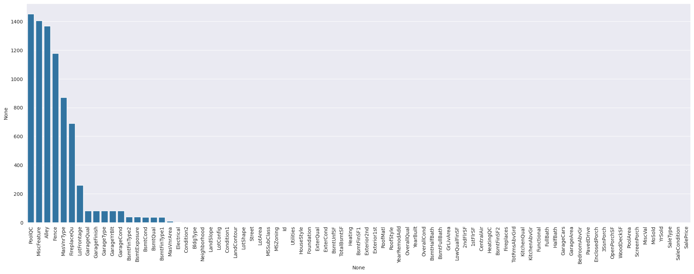
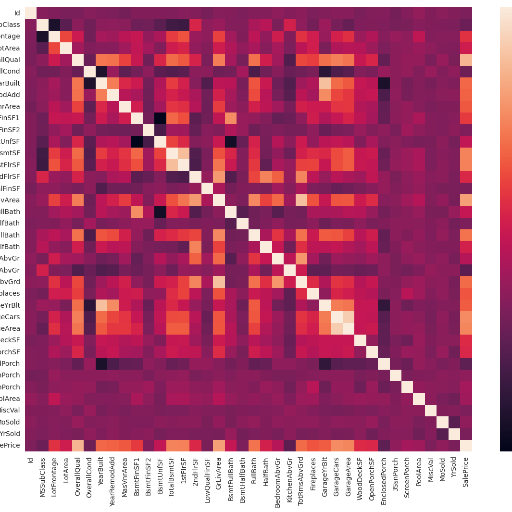

https://www.kaggle.com/code/lazer999/top-1-housing-price-eda-random-for-everyone/notebook  

# 1.导入库文件
```python
import pandas as pd 
```  
这个就是读数据、处理表格。


```python
import seaborn as sns
import matplotlib.pyplot as plt
sns.set_style('darkgrid')
```
画图工具。`seaborn` 是 `matplotlib` 的'美化版'，画统计图更省事（一行代码出热力图、分布图）。  
sns.set_style('darkgrid') 只是设置图表风格为灰底网格，纯外观。 

```python
from sklearn.model_selection import train_test_split
```
切割训练集/验证集

```python
from sklearn.metrics import mean_absolute_error
```
算MAE

```python
from sklearn.ensemble import GradientBoostingRegressor
```
**梯度提升回归器**。和随机森林同一个家族（集成学习），但机制不同：
||随机森林|梯度提升|
|-|-|-|
|训练方式|100棵树**同时**独立训练|100棵树**串行**，后一棵树专门修正前一棵树的错误|
|类比|100个人各自答题，投票|100个学生接力改同一份卷子，每人只改错的地方|
|效果|好|通常**更好**，但对参数更敏感|  

用法和随机森林 完全一样 ：`model.fit(X, y)` →`model.predict(X_test)` 。这就是 sklearn 统一接口的好处。  

##### 问题：混合类型数据太麻烦  
数据有81列，分为两种：
1. 数值列：LotArea、GrLivArea、YearBuilt   → 缺失值要填中位数
2. 类别列：Neighborhood、SaleCondition     → 缺失值要填"None"，还要转 0/1 编码  
现在有两个麻烦：
1. 手动处理两边要写两套代码 ，容易乱  
2. 致命问题 ：用训练集算出的中位数去填验证集，才不会数据泄漏；但手动做很容易用全量数据算中位数 → 泄漏 

### 解决的办法是使用 `SimpleImputer`，`OneHotEncoder`，`ColumnTransformer`，`Pipeline`
#### SimpleImputer —— 填缺失值的机器人
```python
from sklearn.impute import SimpleImputer
```  
```python
SimpleImputer(strategy='median')      # 用中位数填  
SimpleImputer(strategy='most_frequent')  # 用众数填（类别列用）
```  
它记住"训练集的中位数是多少"，之后对验证集/测试集都 **用同一个值** 填。这就防住了数据泄漏。

#### OneHotEncode —— 类别转数字的机器人
```python
from sklearn.preprocessing import OneHotEncoder
```  
```python
OneHotEncoder(handle_unknown='ignore')
```  
- `handle_unknown='ignore'` ：测试集出现训练集没见过的类别时，不报错，直接全 0
- 它会记住训练时的类别列表，保证训练集和测试集编码出的列完全一致

#### ColumnTransformer —— 分发器
```python
from sklearn.compose import ColumnTransformer
```  
```python
ColumnTransformer(transformers=[
    ('num', 数值列的处理流程, 数值列名列表),
    ('cat', 类别列的处理流程, 类别列名列表),
])
```
作用就一句话： "**数值列走左边这条路，类别列走右边这条路**" ，各自用各自的机器人处理。

#### Pipeline —— 流水线 
```python
from sklearn.pipeline import Pipeline
``` 
```python
Pipeline(steps=[
    ('prep', ColumnTransformer对象),
    ('model', GradientBoostingRegressor()),
])
```  
把"预处理"和"模型"焊成一个整体。之后你只需要：    
```python
pipe.fit(train_X, train_y)          # 预处理 + 训练，一步完成  
preds = pipe.predict(val_X)          # 预处理 + 预测，一步完成
```  
**关键好处：预处理被"包"在模型里了**。 交叉验证时，每一折都会 **独立地** 用该折的训练部分算中位数/类别列表，绝对不会泄漏。手动做几乎做不到这一点。


# 2. 加载数据

```python
df_train = pd.read_csv('/kaggle/input/competitions/home-data-for-ml-course/train.csv')
df_test = pd.read_csv('/kaggle/input/competitions/home-data-for-ml-course/test.csv')

df_train.head()
```
读取训练集和测试集，查看前五行  


# 3.让我们去探索吧！！！

## 3.1 查看数据范围有多大
```python
r, c = df_train.shape
print(f"The training data has {r} rows and {c} columns")
r, c = df_test.shape
print(f"The validation data has {r} rows and {c} columns")

# The training data has 1460 rows and 81 columns
# The validation data has 1459 rows and 80 columns
```

## 3.2 查看每列是什么类型的数据，缺失值有多少
```python
df_train.info()

# <class 'pandas.core.frame.DataFrame'>
# RangeIndex: 1460 entries, 0 to 1459
# Data columns (total 81 columns):
#  '#'   Column         Non-Null Count  Dtype  
# ---  ------         --------------  -----  
#  0   Id             1460 non-null   int64  
#  1   MSSubClass     1460 non-null   int64  
#  2   MSZoning       1460 non-null   object 
#  3   LotFrontage    1201 non-null   float64
#  4   LotArea        1460 non-null   int64  
#  5   Street         1460 non-null   object 
#  6   Alley          91 non-null     object 
#  7   LotShape       1460 non-null   object 
#  8   LandContour    1460 non-null   object 
#  9   Utilities      1460 non-null   object 
#  10  LotConfig      1460 non-null   object 
#  11  LandSlope      1460 non-null   object 
#  12  Neighborhood   1460 non-null   object 
#  13  Condition1     1460 non-null   object 
#  14  Condition2     1460 non-null   object 
#  15  BldgType       1460 non-null   object 
#  16  HouseStyle     1460 non-null   object 
#  17  OverallQual    1460 non-null   int64  
#  18  OverallCond    1460 non-null   int64  
#  19  YearBuilt      1460 non-null   int64  
#  20  YearRemodAdd   1460 non-null   int64  
#  21  RoofStyle      1460 non-null   object 
#  22  RoofMatl       1460 non-null   object 
#  23  Exterior1st    1460 non-null   object 
#  24  Exterior2nd    1460 non-null   object 
#  25  MasVnrType     588 non-null    object 
#  26  MasVnrArea     1452 non-null   float64
#  27  ExterQual      1460 non-null   object 
#  28  ExterCond      1460 non-null   object 
#  29  Foundation     1460 non-null   object 
#  30  BsmtQual       1423 non-null   object 
#  31  BsmtCond       1423 non-null   object 
#  32  BsmtExposure   1422 non-null   object 
#  33  BsmtFinType1   1423 non-null   object 
#  34  BsmtFinSF1     1460 non-null   int64  
#  35  BsmtFinType2   1422 non-null   object 
#  36  BsmtFinSF2     1460 non-null   int64  
#  37  BsmtUnfSF      1460 non-null   int64  
#  38  TotalBsmtSF    1460 non-null   int64  
#  39  Heating        1460 non-null   object 
#  40  HeatingQC      1460 non-null   object 
#  41  CentralAir     1460 non-null   object 
#  42  Electrical     1459 non-null   object 
#  43  1stFlrSF       1460 non-null   int64  
#  44  2ndFlrSF       1460 non-null   int64  
#  45  LowQualFinSF   1460 non-null   int64  
#  46  GrLivArea      1460 non-null   int64  
#  47  BsmtFullBath   1460 non-null   int64  
#  48  BsmtHalfBath   1460 non-null   int64  
#  49  FullBath       1460 non-null   int64  
#  50  HalfBath       1460 non-null   int64  
#  51  BedroomAbvGr   1460 non-null   int64  
#  52  KitchenAbvGr   1460 non-null   int64  
#  53  KitchenQual    1460 non-null   object 
#  54  TotRmsAbvGrd   1460 non-null   int64  
#  55  Functional     1460 non-null   object 
#  56  Fireplaces     1460 non-null   int64  
#  57  FireplaceQu    770 non-null    object 
#  58  GarageType     1379 non-null   object 
#  59  GarageYrBlt    1379 non-null   float64
#  60  GarageFinish   1379 non-null   object 
#  61  GarageCars     1460 non-null   int64  
#  62  GarageArea     1460 non-null   int64  
#  63  GarageQual     1379 non-null   object 
#  64  GarageCond     1379 non-null   object 
#  65  PavedDrive     1460 non-null   object 
#  66  WoodDeckSF     1460 non-null   int64  
#  67  OpenPorchSF    1460 non-null   int64  
#  68  EnclosedPorch  1460 non-null   int64  
#  69  3SsnPorch      1460 non-null   int64  
#  70  ScreenPorch    1460 non-null   int64  
#  71  PoolArea       1460 non-null   int64  
#  72  PoolQC         7 non-null      object 
#  73  Fence          281 non-null    object 
#  74  MiscFeature    54 non-null     object 
#  75  MiscVal        1460 non-null   int64  
#  76  MoSold         1460 non-null   int64  
#  77  YrSold         1460 non-null   int64  
#  78  SaleType       1460 non-null   object 
#  79  SaleCondition  1460 non-null   object 
#  80  SalePrice      1460 non-null   int64  
# dtypes: float64(3), int64(35), object(43)
# memory usage: 924.0+ KB
```
#### 前三行数据：
```python
<class 'pandas.core.frame.DataFrame'>   → 这是个 DataFrame
RangeIndex: 1460 entries, 0 to 1459     → 1460 行，索引从 0 到 1459
Data columns (total 81 columns):        → 共 81 列
```

#### 中间部分的那张表：
|字段|含义|
|-|-|
|#|列的位置编号（0, 1, 2…）|
|Column|列名|
|Non-Null Count|这一列有多少个非空值|
|Dtype|这一列的数据类型|
拿`LotFrontage` 举例：`1201 non-null` 。总行数是 1460，所以缺失 = 1460 − 1201 = 259 。
**这个减法就是 info() 最实用的地方** ：你不用另外写`isnull()` ，扫一眼就知道哪列缺。反过来，凡是写着`1460 non-null` 的列（比如`Id` 、`MSSubClass` ）就是完全干净的。

#### 三种dtype需要分清楚
```python
int64    → 整数
float64  → 小数
object   → 文本（字符串）
``` 
最后的汇总就是告诉所有列名的数据类型的个数之和
```python
dtypes: float64(3), int64(35), object(43)
```

#### 坑1：dtype 是 pandas 对存储格式的判断，不是对语义的判断。  
看`MSSubClass` ：dtype 是`int64` ，看起来是数字。但它其实是 **建筑类型的编码** ——20 代表 1 层半，60 代表 2 层，120 代表 1 层……这些数字的大小 **没有任何数学含义** ，120 不代表“比 20 大 6 倍”。
比如还有：  
`OverallQual` /`OverallCond` ：int64，但语义是 1~10 的 等级评分 （有序类别）  
`YearBuilt` /`YearRemodAdd` ：int64，但语义是 年份 ，算平均值没意义  
`MoSold` ：int64，但语义是月份，12 月和 1 月是相邻的  

## 3.3 绘制柱状图直观表示缺失值的情况
```python
plt.figure(figsize = (24, 8))
cols_with_null = df_train.isnull().sum().sort_values(ascending = False)
sns.barplot(x = cols_with_null.index, y = cols_with_null)

plt.xticks(rotation = 90)
plt.show()

cols_with_null[0:20:1]

# PoolQC          1453
# MiscFeature     1406
# Alley           1369
# Fence           1179
# MasVnrType       872
# FireplaceQu      690
# LotFrontage      259
# GarageQual        81
# GarageFinish      81
# GarageType        81
# GarageYrBlt       81
# GarageCond        81
# BsmtFinType2      38
# BsmtExposure      38
# BsmtCond          37
# BsmtQual          37
# BsmtFinType1      37
# MasVnrArea         8
# Electrical         1
# Condition2         0
# BldgType           0
# Neighborhood       0
# LandSlope          0
# LotConfig          0
# Condition1         0
# LandContour        0
# LotShape           0
# Street             0
# LotArea            0
# MSSubClass         0
# dtype: int64
```
  
  
- plt.figure(figsize = (24, 8))  
    `plt.figure()` 的意思是“新建一张空白画布”。它的参数`figsize` 是画布的尺寸，单位是 英寸 ，括号里写`(宽, 高)` 。   

    这里设为 24 × 8 英寸，按 matplotlib 默认的 100 dpi 计算，实际输出约为 2400 × 800 像素 ，即一张很宽的横图。

    之所以 之所以要设置得这么宽，是因为横轴上有 81 个列名；如果改用默认的 6.4 × 4.8 英寸，列名会重叠到互相无法分辨。

    这一步必须放在画图之前。如果先画图、再调整画布大小，图已经画在旧画布上了。  

- cols_with_null = df_train.isnull().sum().sort_values(ascending = False)  
    需要操作的对象是df_train。  
    然后 .isnull() 方法可以判断每个元素是否为空。   
    再然后 .sum() 方法可以统计每个列的缺失值数量。  
    最后 .sort_values(ascending = False) 方法可以按缺失值数量从大到小排序。其中ascending = False 表示按缺失值数量从大到小排序。如果不写，默认是按缺失值数量从小到大排序。 

- sns.barplot(x = cols_with_null.index, y = cols_with_null)  
    画柱状图，`barplot` 需要指定两个轴分别放什么：  
    `x` 放进的是 `cols_with_null.index` ，也就是那 81 个列名。`.index` 是 Series 的“标签”部分，这里就是列名。   
    `y` 放进的是 `cols_with_null` ，也就是那 81 个缺失值数量。`.values` 是 Series 的“数据”部分，这里就是缺失值数量。   

- plt.xticks(rotation = 90)  
    `xticks` 是“x 轴刻度”，`rotation` 是旋转角度。`90` 表示逆时针旋转 90 度，文字变成竖排。  
    81 个英文列名（`GarageFinish` 、`BsmtExposure` 这种长词）横着排根本放不下，转成竖排才勉强挤得进去。  
    如果觉得文字是从下往上读、别扭，可以改成`rotation = -90` ，就变成从上往下读了。  
    这一行 必须在 barplot 之后 ，因为刻度是画图时才生成出来的，图还没画就去改刻度会报错或无效。  


#### 这个cols_with_null 是一个 Series ，它的索引是列名，值是缺失值数量。

#### 成组缺失不是巧合 
```python
GarageQual        81
GarageFinish      81
GarageType        81
GarageYrBlt       81
GarageCond        81
BsmtFinType2      38
BsmtExposure      38
BsmtCond          37
BsmtQual          37
BsmtFinType1      37
```   
Garage 的五列全是 81，Bsmt 的几列全是 38——说明是 **同一批房子** 同时缺这些列。一批房子没有车库，所以车库的类型、年份、装修、质量、状况全都填不了；同理，一批房子没有地下室。


## 对于缺失值的处理，可以直接删除缺失值，但是这样会丢失一些信息，大佬最终没有选择删除缺失值。 
```python
#cols_to_drop=(cols_with_null.head(6).index).tolist()
#df_train.drop(cols_to_drop,axis=1,inplace=True)
#df_test.drop(cols_to_drop,axis=1,inplace=True)
#df_train.shape
```  

- cols_to_drop=(cols_with_null.head(6).index).tolist()  
    将缺失值前 6 个列的索名转换为列表。
- df_train.drop(cols_to_drop,axis=1,inplace=True)  
    删除缺失值前 6 个列。  
    axis = 0 表示按列删除, axis = 1 表示按行删除。  
    inplace = True 表示在原数据上操作，不返回新的数据。    

#### 为什么他最终放弃了这个思路？
删掉这 6 列，等于把 PoolQC、Alley、Fence、FireplaceQu 也一起丢掉了。而这四列的 NaN 并不是真的“缺失”：  
- 1453 个 PoolQC 空 → 只有 7 套房有泳池
- 1179 个 Fence 空 → 只有 281 套房有围栏  
- 690 个 FireplaceQu 空 → 差不多一半房子没壁炉

“**有没有泳池、有没有围栏、有没有壁炉”本身就是影响房价的强特征** ，删掉等于主动丢弃信息。

## 简要列出一些特点  

### 相关热力图
```python
plt.figure(figsize = (15, 12))
sns.heatmap(df_train.corr(numeric_only = True))
plt.show()
```

- sns.heatmap() 是画热力图的函数。 
    热力图（heatmap） 。它把一个二维表格的数字，用 颜色 画成一片网格：    
    左边一排标签代表行，底下那排标签代表列，每个格子的颜色深浅，代表行和列交叉位置上的那个数字  
    它的作用就是让“数字大小”变成“一眼能看出的颜色差异”，适合快速发现规律，不适合查精确值。
- df_train.corr()  
    `corr` 是 correlation（相关性）的缩写。它做的事是： **把 38 个数值列两两配对，每一对算出一个相关系数** ，最后得到一个 38 × 38 的表。  
    相关系数衡量的是“两个变量是否同涨同跌”，取值范围 −1 到 +1 ：  
    |值|含义|例子|
    |--|----|---|
    |接近 +1|一个涨，另一个也涨|面积越大，房价越高|
    |接近 0|没有线性关系|门牌号和房价|
    |接近 −1|一个涨，另一个跌|房龄越大，价格越低（理论上）|  
    所以`df_train.corr()` 本身就是一个 **38 × 38 的 DataFrame** ，行名和列名都是特征名。正因为它是规整的数字表，才能直接交给`heatmap` 去涂色。
- numeric_only = True 
    `corr()` 内部的第一步是： 把整张表转换成一个纯数字矩阵 ，然后才能做数学运算。  
    `numeric_only = True` 表示只考虑数值列，不考虑非数值列。  
    非数值列（如 `PoolQC` `Alley` `Fence` `FireplaceQu` 等）在转换为纯数字矩阵时会被跳过，所以最终得到的矩阵中不会出现非数值列的特征。  


#### 热力图可以帮助我们发现哪些特征与目标变量（SalePrice）相关性高    
直接看 最底下一行 （或者最右边一列，一样）。  

横着扫过去，凡是颜色偏浅、发橘发粉的格子，就是和房价正相关的特征。

能明显看出偏浅的是：OverallQual     YearBuilt     YearRemodAdd....  

**更加实用的还是排序，直接将所有特征与SalePrice的相关性排序出来：**
```python
corr = df_train.corr(numeric_only=True)
corr['SalePrice'].sort_values(ascending=False)
# SalePrice        1.000000
# OverallQual      0.790982
# GrLivArea        0.708624
# GarageCars       0.640409
# GarageArea       0.623431
# TotalBsmtSF      0.613581
# 1stFlrSF         0.605852
# FullBath         0.560664
# TotRmsAbvGrd     0.533723
# YearBuilt        0.522897
# YearRemodAdd     0.507101
# GarageYrBlt      0.486362
# MasVnrArea       0.477493
# Fireplaces       0.466929
# BsmtFinSF1       0.386420
# LotFrontage      0.351799
# WoodDeckSF       0.324413
# 2ndFlrSF         0.319334
# OpenPorchSF      0.315856
# HalfBath         0.284108
# LotArea          0.263843
# BsmtFullBath     0.227122
# BsmtUnfSF        0.214479
# BedroomAbvGr     0.168213
# ScreenPorch      0.111447
# PoolArea         0.092404
# MoSold           0.046432
# 3SsnPorch        0.044584
# BsmtFinSF2      -0.011378
# BsmtHalfBath    -0.016844
# MiscVal         -0.021190
# Id              -0.021917
# LowQualFinSF    -0.025606
# YrSold          -0.028923
# OverallCond     -0.077856
# MSSubClass      -0.084284
# EnclosedPorch   -0.128578
# KitchenAbvGr    -0.135907
# Name: SalePrice, dtype: float64
```


# 4. 异常值检测  
```python
fig, ax=plt.subplots(1,3,figsize=(28,7))
sns.scatterplot(x=df_train.GrLivArea,y=df_train.SalePrice,size=df_train.BedroomAbvGr,hue=df_train.OverallQual, ax=ax[0])
ax[0].set_title("Ground Living Area")
sns.scatterplot(x=df_train.LotArea,y=df_train.SalePrice,size=df_train.BedroomAbvGr,hue=df_train.OverallQual, ax=ax[1])
ax[1].set_title("LOT AREA")
sns.boxplot(x=df_train.SalePrice);
```  


