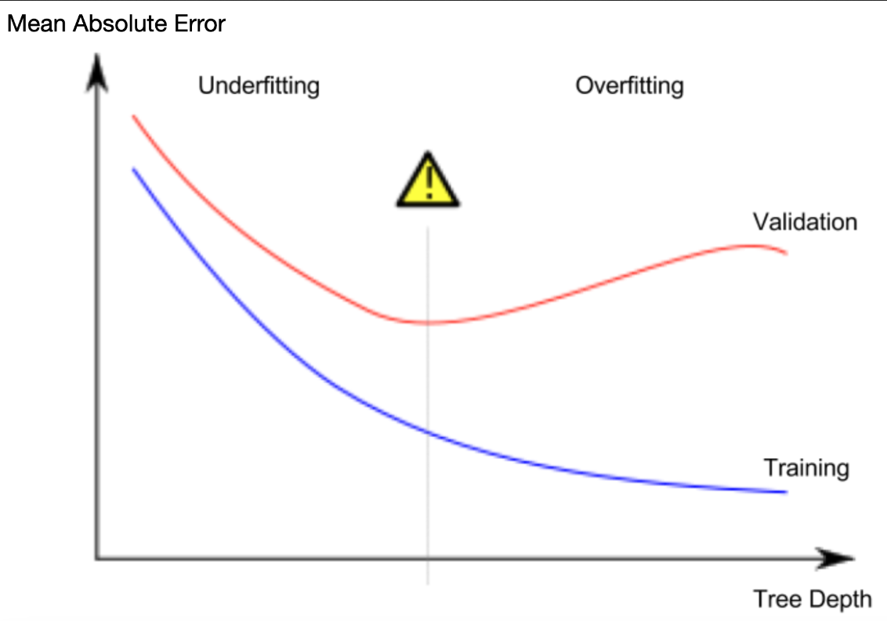

### Tutorial  

Fine-tune your model for better performance.   


#### 尝试不同的模型  

在实践中，一棵树在顶层（所有房屋）和一片叶子之间有10个裂缝并不罕见。随着树越来越深，数据集被切成叶子，房子越来越少。如果一棵树只有1个分割，它会将数据分为2组。如果每组再次拆分，我们将得到4组房屋。再次拆分每个组将创建8个组。如果我们通过在每个级别添加更多分割来将组的数量增加一倍，那么到第10级时，我们将有2^10组房屋。这是1024片叶子。   

当我们把房子分成许多叶子时，每片叶子上的房子也会减少。房屋很少的叶子会做出非常接近这些房屋实际价值的预测，但它们可能会对新数据做出非常不可靠的预测（因为每个预测都只基于少数房屋）。   

这是一种称为`过拟合`的现象，其中模型几乎完全匹配训练数据，但在验证和其他新数据方面表现不佳。另一方面，如果我们把树做得很浅，它就不会把房子分成非常不同的组。    

在极端情况下，如果一棵树只把房子分成2或4个，每个组仍然有各种各样的房子。对于大多数房屋来说，即使在训练数据中，最终的预测也可能很遥远（出于同样的原因，验证也会很糟糕）。当一个模型未能捕捉到数据中的重要区别和模式时，即使在训练数据中也表现不佳，这被称为`欠拟合`。  

由于我们关心新数据的准确性，我们根据验证数据进行估计，因此我们想找到欠拟合和过拟合之间的最佳点。从视觉上看，我们想要下图中（红色感叹号）验证曲线的低点。  

  

有几种方法可以控制树的深度，许多方法允许通过树的某些路线比其他路线具有更好的深度。但是`max_lef_nodes`参数提供了一种非常合理的方法来控制过拟合与欠拟合。我们允许模型制作的叶子越多，我们就越能从上图中的欠拟合区域移动到过拟合区域。  

我们可以使用一个实用函数来帮助比较max_lef_nodes的不同值的MAE分数：    

```python
from sklearn.metrics import mean_absolute_error
from sklearn.tree import DecisionTreeRegressor

def get_mae(max_leaf_nodes, train_X, val_X, train_y, val_y):
    model = DecisionTreeRegressor(max_leaf_nodes=max_leaf_nodes, random_state=0)
    model.fit(train_X, train_y)
    preds_val = model.predict(val_X)
    mae = mean_absolute_error(val_y, preds_val)
    return(mae)
```  

我们可以使用for循环来比较使用max_lef_nodes的不同值构建的模型的准确性。  

```python
# compare MAE with differing values of max_leaf_nodes
for max_leaf_nodes in [5, 50, 500, 5000]:
    my_mae = get_mae(max_leaf_nodes, train_X, val_X, train_y, val_y)
    print("Max leaf nodes: %d  \t\t Mean Absolute Error:  %d" %(max_leaf_nodes, my_mae))

# 输出：
# Max leaf nodes: 5  		 Mean Absolute Error:  347380
# Max leaf nodes: 50  		 Mean Absolute Error:  258171
# Max leaf nodes: 500  		 Mean Absolute Error:  243495
# Max leaf nodes: 5000  		 Mean Absolute Error:  254983
```
在列出的选项中，500是最佳的叶子数量。  


#### 结论  

以下是结论：模型可能会受到以下两种情况的影响：  
- 过度拟合：捕捉未来不会再次出现的虚假模式，导致预测不准确  
- 拟合不足：未能捕捉到相关模式，再次导致预测不准确。  

我们使用模型训练中不使用的验证数据来衡量候选模型的准确性。这让我们尝试了许多候选模型，并保留了最好的一个。  

### 总结开始  --------------------------------------------------------------------------------------------------------------------------------------------------------------------------------------
#### 对于过拟合的理解：  
数据 = 信号（规律）+ 噪声（偶然）；切太深会把噪声当规律刻进模型；训练集完美，新数据崩。    

数据中的特征信息分为两部分： 真正的信号（会重复的规律） 和 噪声（不会重演的偶然） 。适度的切割能提取信号；切得过深时，真信号已被切尽，剩下的切分只能落在噪声上，模型就把偶然当成了规律。这时它对 训练数据 的判断近乎完美（因为答案被记住了），但对 没见过的验证数据 误差反而越来越大。而且"最佳切分深度"并非固定值—— 数据量越大，能承载的复杂度越高，甜点越深 。  


### 总结结束  --------------------------------------------------------------------------------------------------------------------------------------------------------------------------------------


### Exercise  

```python
# Code you have previously used to load data
import pandas as pd
from sklearn.metrics import mean_absolute_error
from sklearn.model_selection import train_test_split
from sklearn.tree import DecisionTreeRegressor


# Path of the file to read
iowa_file_path = '../input/home-data-for-ml-course/train.csv'

home_data = pd.read_csv(iowa_file_path)
# Create target object and call it y
y = home_data.SalePrice
# Create X
features = ['LotArea', 'YearBuilt', '1stFlrSF', '2ndFlrSF', 'FullBath', 'BedroomAbvGr', 'TotRmsAbvGrd']
X = home_data[features]

# Split into validation and training data
train_X, val_X, train_y, val_y = train_test_split(X, y, random_state=1)

# Specify Model
iowa_model = DecisionTreeRegressor(random_state=1)
# Fit Model
iowa_model.fit(train_X, train_y)

# Make validation predictions and calculate mean absolute error
val_predictions = iowa_model.predict(val_X)
val_mae = mean_absolute_error(val_predictions, val_y)
print("Validation MAE: {:,.0f}".format(val_mae))

# Set up code checking
from learntools.core import binder
binder.bind(globals())
from learntools.machine_learning.ex5 import *
print("\nSetup complete")
```    

你可以自己编写这个函数 `get_mae` 。不过，目前我们会提供这个函数的实现代码。这和你在前一节课中读到的那个函数是一模一样的。只需运行下面的单元格即可。   
```python
def get_mae(max_leaf_nodes, train_X, val_X, train_y, val_y):
    model = DecisionTreeRegressor(max_leaf_nodes=max_leaf_nodes, random_state=0)
    model.fit(train_X, train_y)
    preds_val = model.predict(val_X)
    mae = mean_absolute_error(val_y, preds_val)
    return(mae)
```  

步骤 1：比较不同树木的大小

编写一个循环，尝试为 `max_leaf_nodes` 设置一系列可能的值。  

对每一个`max_leaf_nodes`的值，都调用`get_mae`函数。将输出结果以某种方式存储起来，这样就能选出在您的数据上能产生最精确模型的 `max_leaf_nodes` 值。  

```python
candidate_max_leaf_nodes = [5, 25, 50, 100, 250, 500]
# Write loop to find the ideal tree size from candidate_max_leaf_nodes

tree_size, predict_mae = -1, 1000000000000000000000000000
for leaf_nodes in candidate_max_leaf_nodes:
    now_predict_mae = get_mae(leaf_nodes, train_X, val_X, train_y, val_y)
    if now_predict_mae < predict_mae:
        tree_size = leaf_nodes
        predict_mae = now_predict_mae    

# Store the best value of max_leaf_nodes (it will be either 5, 25, 50, 100, 250 or 500)
best_tree_size = tree_size

# Check your answer
step_1.check()  

# Here is a short solution with a dict comprehension.
# The lesson gives an example of how to do this with an explicit loop.
# scores = {leaf_size: get_mae(leaf_size, train_X, val_X, train_y, val_y) for leaf_size in candidate_max_leaf_nodes}
# best_tree_size = min(scores, key=scores.get)
```  

#### 步骤 2：使用所有数据来拟合模型  

你知道最佳的树木规模应该是多少吧。如果你打算在实际中应用这个模型，那么利用所有数据来做出更准确的预测，同时保持固定的树木规模是非常重要的。也就是说，既然你已经完成了所有的建模决策，那么现在就不需要再保留验证数据了。  

```python
# Fill in argument to make optimal size and uncomment
final_model = DecisionTreeRegressor(max_leaf_nodes = best_tree_size, random_state = 1)

# fit the final model and uncomment the next two lines
final_model.fit(X, y)

# Check your answer
step_2.check()
```  


### 总结开始  --------------------------------------------------------------------------------------------------------------------------------------------------------------------------------------
#### 简洁求字典中value最小值的key   

```python
scores = {leaf_size: get_mae(leaf_size, train_X, val_X, train_y, val_y) for leaf_size in candidate_max_leaf_nodes}
best_tree_size = min(scores, key=scores.get)
```

对于一个字典 dic 来说，如果直接是 min(dic)，那么得到的是 key 的最小值，和 value 没有任何关系  
如果是 min(dic, key=dic.get)，那么得到的是 value 最小值的 key


### 总结结束  --------------------------------------------------------------------------------------------------------------------------------------------------------------------------------------