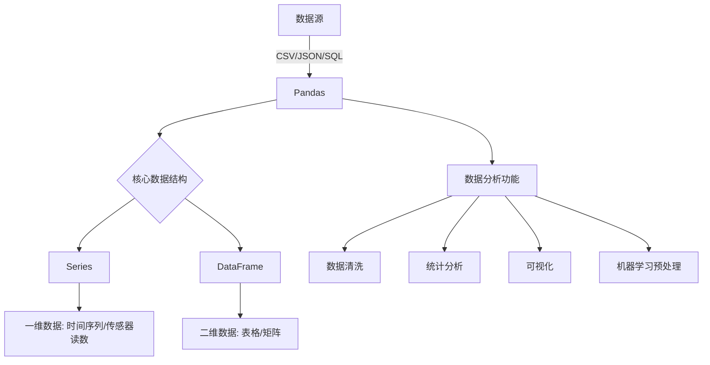

Pandas是Python数据分析工具链中最核心的库，充当数据读取、清洗、分析、统计、输出的高效工具。  
Pandas提供了易于使用的数据结构和数据分析工具，特别适用于处理结构化数据，如表格型数据（类似于Excel表格）。  
Pandas是数据科学和分析领域中常用的工具之一，它使得用户能够轻松地从各种数据源中导入数据，并对数据进行高效的操作和分析。  
Pandas是基于Numpy构建的专门为处理表格和混杂数据设计的Python库，核心设计理念包括：  
- 标签化数据结构：提供带标签的轴
- 灵活处理缺失数据“内置NaN处理机制
- 智能数据对其：自动按标签对齐数据
- 强大的IO工具：支持从CSVB、Excel、SQL等20+数据源读写
- 书简序列处理：原生支持日期时间处理和频率转换

|工具|功能特色|适用场景|
|----|--------|--------|
|Excel|图形界面，简单上手|人工分析、小规模数据|
|SQL|高效读写，最终数据源|数据库查写和联表|
|Python+Pandas|算法和分析部署|数据清洗，统计分析，可视化等|

|特性|Series|DataFrame|
|----|------|---------|
|维度|一维|二维|
|索引|单索引|索引行+列名|
|数据存储|同质化数据类型|各列可不同数据类型|
|类比|Excel单列|整张Excel工作表|
|创建方式|pd.Series([1, 2, 3])|pa.DataFrame({'col':[1, 2, 3]})

