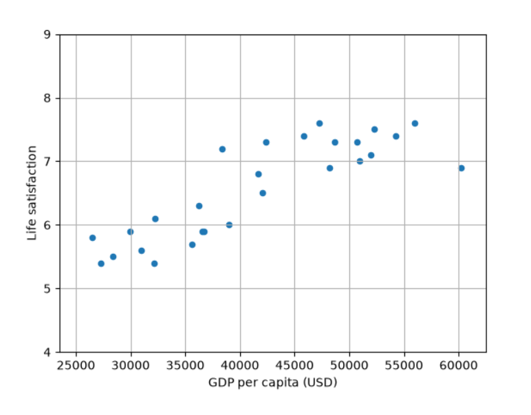

## 机器学习的定义  

`机器学习`是一门通过编程让计算机从数据中进行学习的科学（和艺术）。  

机器学习是一个研究领域让计算机无须进行明确编程就具备学习能力。   

一个计算机程序利用经验E来学习任务T，性能是P，如果针对任务T的性能P随着经验E不断增长，则称为机器学习。  

系统用来学习的样例称为`训练集`。  

每个训练样例称为`训练实例`（或样本）。  

机器学习系统中学习和做出预测的部分称为`模型`。  


## 机器学习的类型  

- 们在训练期间是**如何受到监督**（监督、无监督、半监督、自我监督等）的。  
- 们是否可以即时**增量地学习**（在线学习与批量学习）。  
- 们是通过简单地**将新数据与已知数据进行比较**来工作，还是通过**检测训练数据中的模式并建立预测模型**来工作，就像科学家所做的那样（基于实例的学习与基于模型的学习）。  

### 训练监督  

根据训练期间得到的**监督数量**和**监督类型**，可以将机器学习系统分为以下五个主要类别：监督学习、无监督学习、自监督学习、半监督学习和强化学习。  

#### 监督学习  
在监督学习中，提供给包含所需解决方案的算法的训练集，称为**标签**。    

给定一组特征（里程、年龄、品牌等）的情况下来**预测目标数值**，例如汽车的价格。这种任务称为``回归``。    

#### 无监督学习  

训练数据是未标记的  

#### 半监督学习  

由于标记数据通常既耗时又昂贵，因此你通常会有很多未标记的实例而很少有已标记的实例。一些算法可以处理一部分已标记的数据。这称为半监督学习。  


#### 自监督学习  

机器学习的另一种方法可以是从完全未标记的数据集生成完全标记的数据集。同样，一旦标记了整个数据集，就可以使用任何监督学习算法。这种方法称为自监督学习。    


#### 强化学习  

这个学习系统可以观察环境，选择和执行动作，并获得回报然后它必须自行学习什么是昀好的方法，称为``策略``，以便随着时间的推移获得昀大的回报。策略定义了智能体在给定情况下应该选择的动作。  


### 批量学习与在线学习  
对机器学习系统进行分类的另一个标准是系统能否从输入数据流中进行增量学习。  

#### 批量学习  

在批量学习中，系统无法进行增量学习：它必须使用所有可用的数据进行训练。这通常会占用大量的时间和计算资源，因此通常需要**离线完成**。首先对系统进行训练，然后将其投入生产环境运行，**就不再学习了**。它只是应用它学到的东西。这称为**离线学习**。  

不幸的是，模型的性能往往会随着时间的推移而慢慢变差，因为世界在不断演进发展，而模型却保持不变。这种现象通常称为``模型腐烂``或``数据漂移``。解决方案是定期**根据最新的数据重新训练模型**。你需要多久做一次取决于用例：如果模型对猫和狗的图片进行分类，它的性能会衰减得很慢，但如果模型处理快速变化的系统，例如对金融市场进行预测，那么它很可能会衰减得相当快。  


#### 在线学习  

在在线学习中，通过以单独的数据或小批量的小组数据方式循序地向系统提供数据实例来对系统进行增量训练。每个学习步骤都既快速又便宜，因此系统可以即时学习新数据。  

在线学习对于需要快速适应变化的系统（例如，检测股票市场中的新模式）很有用。  

此外，对于超大数据集——超出一台计算机的主存储器所能容纳的数据，在线学习算法也同样适用[这称为``核外（out-of-core）学习``]。该算法加载部分数据，在该数据上运行一个训练步骤，然后**重复**该过程，直到它在所有数据上运行完。  

在线学习系统的一个重要参数是它们适应不断变化的数据的速度：这称为``学习率``。如果设置的学习率很高，那么系统会快速适应新数据，但它也会很快忘记旧数据（并且你也不希望垃圾邮件过滤器只标记最新的类型的垃圾邮件）。反之，如果设置的学习率很低，那么系统会有更多的惰性，也就是说，它会学习得更慢，但它对新数据中的噪声或非典型数据点（异常值）序列的敏感度也会降低。  

在线学习的一大挑战是，如果将不良数据输入系统，系统的性能可能会迅速下降（取决于数据的质量和学习率）。如果它是实时系统，那么你的客户会注意到这个现象。不良数据的来源可能是机器人的传感器故障，或者有人对搜索引擎恶意刷屏以提高搜索结果排名等。为降低这种风险，**你需要密切监控系统，并在检测到性能下降时立即关闭学习（并尽量恢复到之前的工作状态）**。你可能还想监控输入数据并对异常数据做出反应。

### 基于实例的学习与基于模型的学习  

对机器学习系统进行分类的另一种方法是根据它们的``泛化方式``。大多数机器学习任务都与做出预测有关。这意味着在给定大量训练样例的情况下，系统需要能够对它以前未见到过的样例做出良好的预测（泛化）。在训练数据上有很好的性能是好的，但还不够，真正的目标是在新实例上表现良好。  

泛化方法主要有两种：基于实例的学习和基于模型的学习。  

#### 基于实例的学习  

这称为基于实例的学习：系统用心学习样例，然后通过使用相似性度量将它们与学习到的样例（或它们的子集）进行比较来泛化到新实例。  


#### 基于模型的学习 

对一组样例进行泛化的另一种方法是为这些样例构建一个模型，然后使用该模型进行预测。这称为基于模型的学习  

#### 使用Scikit-Learn训练并运行一个线性模型  
```python
import matplotlib.pyplot as plt
import numpy as np
import pandas as pd

from sklearn.linear_model import LinearRegression

# Download and prepare the data
data_root = "lifesat.csv"
lifesat = pd.read_csv(data_root)

X = lifesat[["GDP per capita (USD)"]].values
y = lifesat[["Life satisfaction"]].values

# Visualize the data
lifesat.plot(kind = 'scatter', grid = True,
             x = "GDP per capita (USD)", y = "Life satisfaction")
plt.axis([23_500, 62_500, 4, 9])
plt.show()

# Select a linear model
model = LinearRegression()

# Train the model
model.fit(X, y)

# Make a prediction for Cyprus
X_new = [[37_655.2]] # Cyprus' GDP per capita in 2020
print(model.predict(X_new)) # output: [[6.30165767]]
```  



