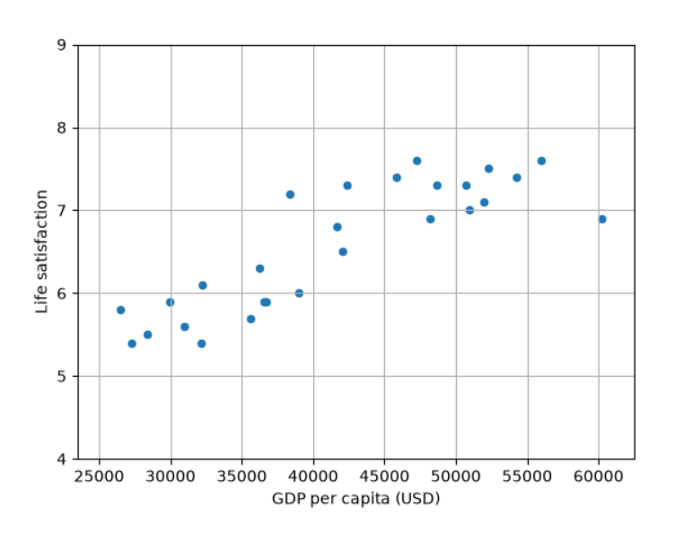

## 机器学习的定义  

`机器学习`是一门通过编程让计算机从数据中进行学习的科学（和艺术）。  

机器学习是一个研究领域让计算机无须进行明确编程就具备学习能力。   

一个计算机程序利用经验E来学习任务T，性能是P，如果针对任务T的性能P随着经验E不断增长，则称为机器学习。  

系统用来学习的样例称为`训练集`。  

每个训练样例称为`训练实例`（或样本）。  

机器学习系统中学习和做出预测的部分称为`模型`。  


## 机器学习的类型  

- 们在训练期间是**如何受到监督**（监督、无监督、半监督、自我监督等）的。  
- 们是否可以即时**增量地学习**（在线学习与批量学习）。  
- 们是通过简单地**将新数据与已知数据进行比较**来工作，还是通过**检测训练数据中的模式并建立预测模型**来工作，就像科学家所做的那样（基于实例的学习与基于模型的学习）。  

### 训练监督  

根据训练期间得到的**监督数量**和**监督类型**，可以将机器学习系统分为以下五个主要类别：监督学习、无监督学习、自监督学习、半监督学习和强化学习。  

#### 监督学习  
在监督学习中，提供给包含所需解决方案的算法的训练集，称为**标签**。    

给定一组特征（里程、年龄、品牌等）的情况下来**预测目标数值**，例如汽车的价格。这种任务称为``回归``。    

#### 无监督学习  

训练数据是未标记的  

#### 半监督学习  

由于标记数据通常既耗时又昂贵，因此你通常会有很多未标记的实例而很少有已标记的实例。一些算法可以处理一部分已标记的数据。这称为半监督学习。  


#### 自监督学习  

机器学习的另一种方法可以是从完全未标记的数据集生成完全标记的数据集。同样，一旦标记了整个数据集，就可以使用任何监督学习算法。这种方法称为自监督学习。    


#### 强化学习  

这个学习系统可以观察环境，选择和执行动作，并获得回报然后它必须自行学习什么是昀好的方法，称为``策略``，以便随着时间的推移获得昀大的回报。策略定义了智能体在给定情况下应该选择的动作。  


### 批量学习与在线学习  
对机器学习系统进行分类的另一个标准是系统能否从输入数据流中进行增量学习。  

#### 批量学习  

在批量学习中，系统无法进行增量学习：它必须使用所有可用的数据进行训练。这通常会占用大量的时间和计算资源，因此通常需要**离线完成**。首先对系统进行训练，然后将其投入生产环境运行，**就不再学习了**。它只是应用它学到的东西。这称为**离线学习**。  

不幸的是，模型的性能往往会随着时间的推移而慢慢变差，因为世界在不断演进发展，而模型却保持不变。这种现象通常称为``模型腐烂``或``数据漂移``。解决方案是定期**根据最新的数据重新训练模型**。你需要多久做一次取决于用例：如果模型对猫和狗的图片进行分类，它的性能会衰减得很慢，但如果模型处理快速变化的系统，例如对金融市场进行预测，那么它很可能会衰减得相当快。  


#### 在线学习  

在在线学习中，通过以单独的数据或小批量的小组数据方式循序地向系统提供数据实例来对系统进行增量训练。每个学习步骤都既快速又便宜，因此系统可以即时学习新数据。  

在线学习对于需要快速适应变化的系统（例如，检测股票市场中的新模式）很有用。  

此外，对于超大数据集——超出一台计算机的主存储器所能容纳的数据，在线学习算法也同样适用[这称为``核外（out-of-core）学习``]。该算法加载部分数据，在该数据上运行一个训练步骤，然后**重复**该过程，直到它在所有数据上运行完。  

在线学习系统的一个重要参数是它们适应不断变化的数据的速度：这称为``学习率``。如果设置的学习率很高，那么系统会快速适应新数据，但它也会很快忘记旧数据（并且你也不希望垃圾邮件过滤器只标记最新的类型的垃圾邮件）。反之，如果设置的学习率很低，那么系统会有更多的惰性，也就是说，它会学习得更慢，但它对新数据中的噪声或非典型数据点（异常值）序列的敏感度也会降低。  

在线学习的一大挑战是，如果将不良数据输入系统，系统的性能可能会迅速下降（取决于数据的质量和学习率）。如果它是实时系统，那么你的客户会注意到这个现象。不良数据的来源可能是机器人的传感器故障，或者有人对搜索引擎恶意刷屏以提高搜索结果排名等。为降低这种风险，**你需要密切监控系统，并在检测到性能下降时立即关闭学习（并尽量恢复到之前的工作状态）**。你可能还想监控输入数据并对异常数据做出反应。

预测：模型对某个具体输入给出输出，比如给一张图片判断是猫还是狗。这是一个“动作/结果”。  
泛化：模型在没见过的数据上仍然表现好的能力。它关注的是预测能力能不能从训练数据推广到新数据、新分布。  


### 泛化方法主要有两种：基于实例的学习和基于模型的学习。

对机器学习系统进行分类的另一种方法是根据它们的``泛化方式``。大多数机器学习任务都与做出预测有关。这意味着在给定大量训练样例的情况下，系统需要能够对它以前未见到过的样例做出良好的预测（泛化）。在训练数据上有很好的性能是好的，但还不够，真正的目标是在新实例上表现良好。  

泛化方法主要有两种：基于实例的学习和基于模型的学习。  

#### 基于实例的学习  

这称为基于实例的学习：系统用心学习样例，然后通过使用相似性度量将它们与学习到的样例（或它们的子集）进行比较来泛化到新实例。  


#### 基于模型的学习 

对一组样例进行泛化的另一种方法是为这些样例构建一个模型，然后使用该模型进行预测。这称为基于模型的学习  

#### 使用Scikit-Learn训练并运行一个线性模型  
```python
import matplotlib.pyplot as plt
import numpy as np
import pandas as pd
from sklearn.linear_model import LinearRegression
```
- scikit-learn（简称sklearn）是一个python库，里面装了几百个现成的机器学习算法。  

```python
lifesat = pd.read_csv("lifesat.csv")
X = lifesat[['GDP per capita (USD)']].values
Y = lifesat[['Life satisfaction']].values
```  
- 这里需要注意 X 一定是二维的就是[[]]，因为数据集lifesat就是一个DataFrame，必须使用二维（样本数，特征数）来表示
- 这里的Y可以是一维的，因为它是一个目标值，只有一个特征。当然写成二维也没关系。  
```python
lifesat.plot(
    kind = 'scatter',
    grid = True,
    x = 'GDP per capita (USD)',
    y = 'Life satisfaction',
)
plt.axis([23_500, 62_500, 4, 9])
plt.show()
```
- lifesat.plot()是pandas的一个方法 
- kind = 'scatter'表示绘制散点图 
- grid = True表示绘制网格 
- x = 'GDP per capita (USD)'表示x轴为GDP per capita (USD)
- y = 'Life satisfaction'表示y轴为Life satisfaction
- plt.axis[]表示设置坐标轴的范围，[x最小值, x最大值, y最小值, y最大值]
- plt.show()表示显示图像
```python
model = LinearRegression()
model.fit(X, Y)
```
- model = LinearRegression()表示一个"假设 y 和 x 是线性关系"的模型，此时它内部是空的，它知道要自己要用`y = θ₀ + θ₁·x`这个形式，但是 θ₀ 和 θ₁ 具体是多少，一概不知。可以验证：  
model = LinearRegression()  
print(model.coef_)  
AttributeError: 'LinearRegression' object has no attribute 'coef_'   
报错恰恰证明它还没学。这是 sklearn 的一个重要约定： 属性名末尾带下划线`_` 的，都是"训练之后才存在"的 （`coef_` 、`intercept_` ）。没`fit` 就访问，一定报错。  
- model.fit(X, Y)表示用训练集 X 和 Y 来训练模型，训练过程就是求解 θ₀ 和 θ₁ 的过程。训练完成后，模型就学会了如何从 GDP per capita (USD) 预测 Life satisfaction。  
sklearn会尝试所有的可能直线，对每一条计算"所有点离这条线的竖直距离的平方和"（这就是MSE，均方误差），然后选出平方和最小的那一条。 误差 = Σ (实际值 - 直线预测值)² 
这个方法叫最小二乘法。它在数学上有闭式解（公式直接算出来），所以线性回归训练是瞬间完成的——按下回车那一刻它已经算完了。  
训练完，模型里多了两个数：  
print(model.intercept_) 3.749   
print(model.coef_)      [6.77889969e-05]  
其实就是：生活满意度 = 3.749 + 0.0000678 × 人均GDP  
```python
X_new = [[37655.2]]
print(model.predict(X_new))
```  

```python
print(model.intercept_)
print(model.coef_)
```  
|sklearn属性|数学符号|值|名字|
|----------|--------|--|----|
|model.intercept_|θ₀|3.749|截距（intercept）|
|model.coef_|θ₁|6.77889969e-05|系数（coefficient），一元时就是斜率|
- `coef_` 为什么是个列表：因为模型里有多个特征，每个特征都有一个对应的系数。这个例子里只有一个特征，所以列表里只有一个数。  
如果模型用了 3 个特征，`coef_` 就会是 3 个数， 顺序和你传给 X 的列顺序一一对应 ：  
X = df[["GDP", "面积", "人口"]].values
coef_ → [0.0000678, -0.35, 0.002]  
- 为什么要带下划线`_`?  
这是 sklearn 的 硬约定： 属性名末尾带下划线`_` 的，都是"训练之后才存在"的 （`coef_` 、`intercept_` ）。没`fit` 就访问，一定报错。


```python
import matplotlib.pyplot as plt
import numpy as np
import pandas as pd
from sklearn.linear_model import LinearRegression

lifesat = pd.read_csv("lifesat.csv")
X = lifesat[['GDP per capita (USD)']].values
Y = lifesat[['Life satisfaction']].values

lifesat.plot(
    kind = 'scatter',
    grid = True,
    x = 'GDP per capita (USD)',
    y = 'Life satisfaction',
)
plt.axis([23_500, 62_500, 4, 9])
plt.show()

model = LinearRegression()
model.fit(X, Y)

X_new = [[37655.2]]
print(model.predict(X_new))  [[6.30165767]]

print(model.intercept_)  [3.74904943]
print(model.coef_)  [[6.77889969e-05]]
``` 
  

#### 过拟合
当模型相对于训练数据的数量和噪声过于复杂时，就会发生过拟合。以下是可能的解决方案：  
- 通过选择参数较少的模型（例如，线性模型而不是高阶多项式模型）、减少训练数据中的属性数量或约束模型来简化模型。
- 收集更多训练数据。
- 减少训练数据中的噪声（例如，修复数据错误并移除异常值）。
通过约束模型使它更简单，并降低过拟合的风险，这个过程称为 `正则化` 。  
学习期间应用的正则化程度可以由 `超参数` 控制。超参数是学习算法（而非模型）的参数。因此，它不受学习算法本身的影响，必须在训练前设置并在训练期间保持不变。  

#### 欠拟合  
欠拟合与过拟合正好相反：当模型太简单而无法学习数据的底层结构时，就会发生欠拟合。以下是解决此问题的主要方式：
- 选择具有更多参数的更强大的模型。
- 为学习算法提供更好的特征（特征工程）。
- 减少对模型的约束（例如通过减少正则化超参数）。 

#### 测试和验证  

将数据分成两组：训练集和测试集。顾名思义，你可以使用训练集训练模型，并使用测试集对其进行测试。新实例的错误率称为`泛化误差`（或样本外误差），通过在测试集上评估模型，你可以获得误差的估计值。这个值能告诉你模型在处理以前从未见过的实例时的表现。

## 练习题
#### 1. 如何定义机器学习？
不写死规则，而是 **让程序从数据中自动找出规律**  。一个程序在任务 T 上、用性能度量 P、随着经验 E 增长而提升，就叫机器学习。  

#### 2. 四类擅长机器学习的应用  
- 规则太复杂、要手写一堆 if-else 的（垃圾邮件过滤）
- 环境会变、需要自适应的（股票预测）
- 数据量大、人工挖不出规律的（用户画像）
- 人类自己也不知道答案的 （外星地貌、新疾病）

#### 3. 什么是"被标记的训练集"？ 
每个样本既含输入特征、也含 **正确答案（label）**  。比如每封邮件都标了"垃圾/正常"。有标签 = 监督学习；没标签 = 无监督。

#### 4. 两种最常见的监督学习任务
- **回归**  （regression）：预测连续数值，如房价、股价
- **分类**  （classification）：预测类别，如垃圾邮件、猫狗

#### 5. 四种常见的无监督学习任
- **聚类**  （clustering，客户分组）
- **降维**  （dimensionality reduction，高维可视化/压缩）
- **异常检测**  （anomaly detection，欺诈识别）
- **关联规则**  （association rule，啤酒与尿布）

#### 6. 机器人在未知地形行走用什么算法？  
- **强化学习**  （reinforcement learning）——没有标准答案，靠"奖励/惩罚"试错学习。 

#### 7. 把客户分成多个组用什么算法？
聚类 （clustering），无监督学习，典型算法 K-Means。

#### 8. 垃圾邮件检测是监督还是无监督？ 
监督学习 （分类）。因为有历史标注的"垃圾/正常"标签可用。 没有标签时才考虑无监督的异常检测。 

#### 9. 什么是在线学习系统？  
用 **数据流持续增量训练** ，每条新数据来了就更新模型，不用重新跑全量。适合：数据量装不下内存、数据分布随时间变化（概念漂移）。核心算法叫 **SGD（随机梯度下降）/ 增量学习** 。

#### 10. 什么是核外学习（out-of-core learning）？  
在线学习的一种实现：数据太大装不进内存，就 **每次从磁盘读一小批（mini-batch）** 训练。原理同 9，区别只在"数据从磁盘来"。

#### 11. 什么算法依赖相似性度量预测？
**基于实例的学习 （instance-based learning）** ，典型是 **k 近邻 （k-NN）** 。它不学参数，只把训练集背下来，预测时找最相似的 k 个邻居投票。  

#### 12. ★ 模型参数和超参数的区别
||参数(parameter)|超参数(hyperparameter)|
|-|-|-|
|谁决定|**训练数据决定** |**人手动决定** |
|例子|coef_、intercept_、神经网络权重|k-NN的k、树的棵树、学习率|
|怎么得到|fit()自动算出来|用验证集/交叉验证来搜|
|命名线索|sklearn里带下划线_|不带下划线|

#### 13. 基于模型的算法搜索什么？ 
搜索 **让模型在训练数据上拟合最好的那组参数** （线性回归就是找使 MSE 最小的 θ）。
- 最常用的成功策略 ： 正则化 （regularization）——给模型加约束，别让它为了贴合训练数据而扭曲得太厉害。
- 如何预测 ：用学到的参数对新样本代入公式算出结果。

#### 14. 机器学习中的主要挑战
- 数据层面 4 个： **数据量不足** 、 **数据不具代表性** （采样偏差）、 **数据质量差** （缺失/异常/噪声）、 **特征不相关** 。
- 模型层面 2 个： **过拟合** （overfitting）、 **欠拟合** （underfitting）。

#### 15. ★ 训练集表现好、新数据表现差 = 过拟合。三种解决方案  
- **简化模型** （减参数、减特征、加正则化）  
- **增加训练数据**
- **清洗数据、减少噪声**

#### 16. ★ 什么是测试集？为什么必须要有？
从数据中 **留出一部分，全程不动** ，只在最后评估一次。因为模型在训练集上的表现必然虚高，只有用"它从没见过"的数据，才能估计 **真实部署后的泛化误差** 。

#### 17. 验证集的目的是什么？
在 **不碰测试集** 的前提下，比较多个模型、调超参数。它替测试集"挨刀"。这就是"训练集/验证集/测试集"三分的原因—— **调参用验证集，评估用测试集** 。

#### 18. 什么是 train-dev 集？什么时候用？
训练数据和真实应用 **分布不一致** 时才需要（例：用网上高清图训练，实际部署在手机模糊照片上）。从 **训练集** 里再划一小块当 train-dev，用来分辨问题来源：
```python
训练集好 + train-dev 差   → 过拟合（模型问题）
train-dev 好 + 验证集差   → 数据不匹配（分布问题）
```
解法：收集更多 接近真实场景 的数据。  

#### 19. ★ 用测试集调超参数会出什么问题？
**信息泄露** 。你会不自觉地把模型"调到在这份测试集上最好"，测试集就变成了验证集，评估结果 **过度乐观** ，上线后真实表现远低于预期。 **测试集只能用一次，用完就"烧掉"**。


